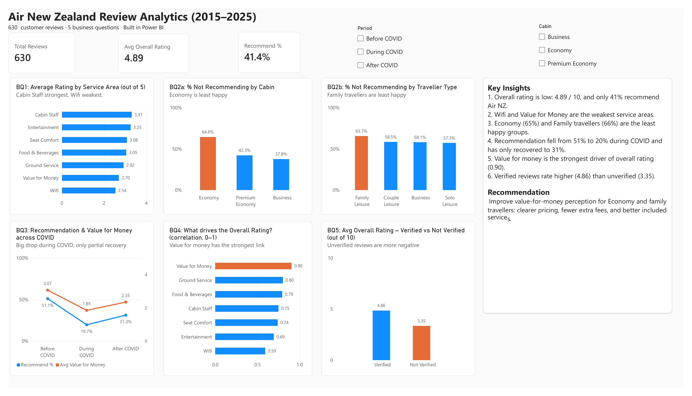
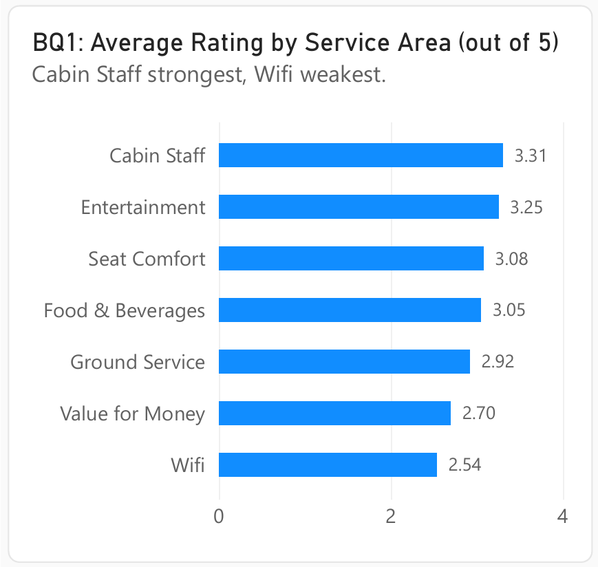
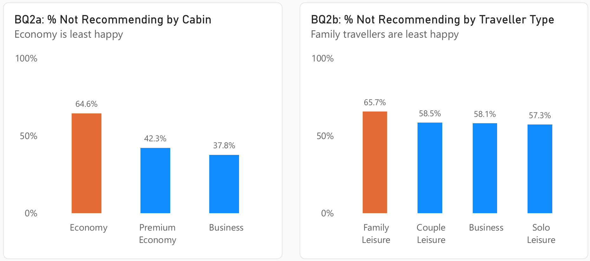
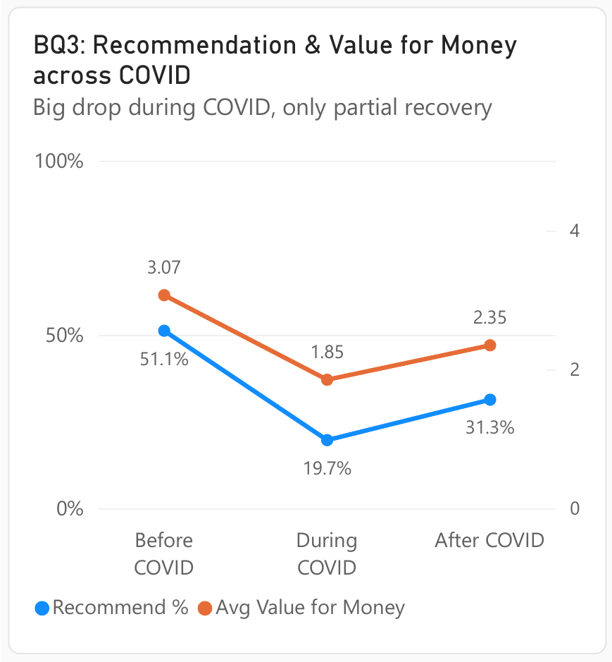
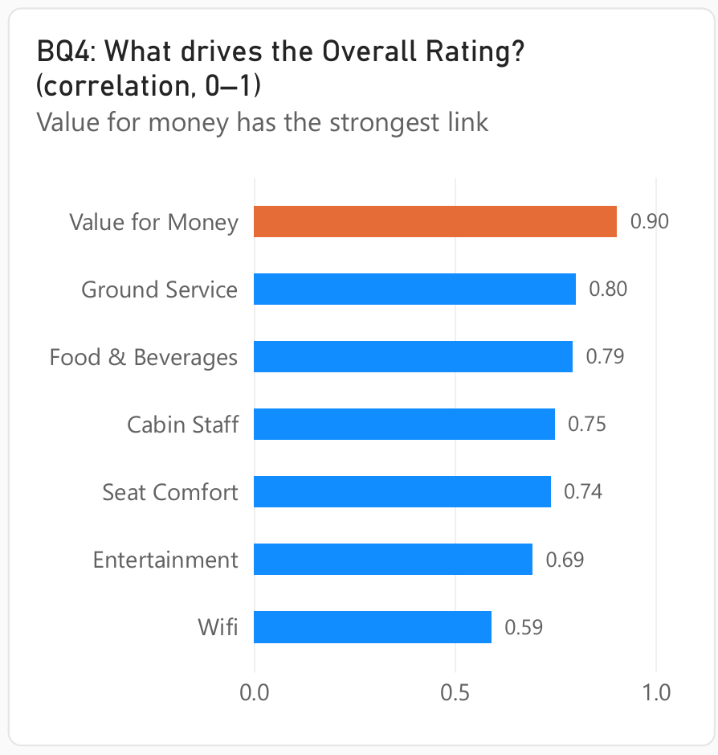
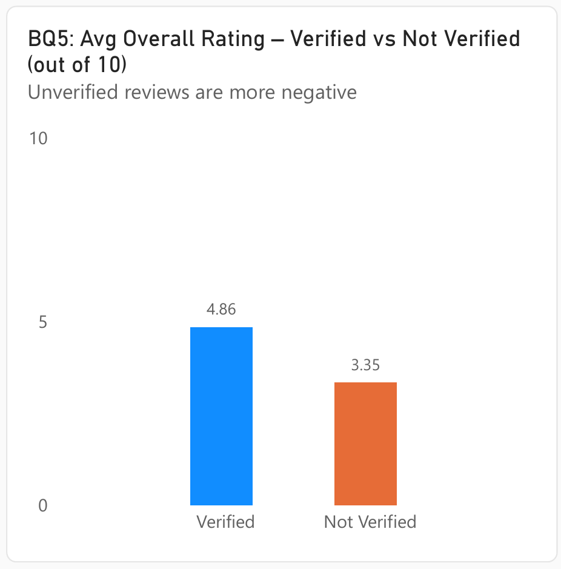

# Air New Zealand Customer Review Analytics (2015–2025)

**Tools:** Microsoft Excel · Power BI (Power Query, DAX) &nbsp;|&nbsp; **Data:** 630 customer reviews &nbsp;|&nbsp; **Author:** Susmita Kumari Giri



> 📄 [Download the dashboard as PDF](AirNZ_Dashboard.pdf) &nbsp;·&nbsp; 📊 [Open the Power BI file (.pbix)](AirNZ_Dashboard.pbix)

---

## 1. Executive Summary

Air New Zealand customer reviews show a **low overall rating of 4.89 out of 10**, and only **41.4% of reviewers recommend the airline**.

The analysis answers five business questions and finds that:

- **Value for money** has the strongest link with the overall rating (correlation **0.90**), and it is also one of the **lowest-rated** service areas (**2.70 / 5**).
- **Economy** passengers (**64.6%**) and **family travellers** (**65.7%**) are the least likely to recommend the airline.
- Recommendation fell sharply **during COVID (51.1% → 19.7%)** and has only partly recovered (**31.3%**).

**Main recommendation:** focus on **value-for-money perception for Economy and family travellers**. This is the area most likely to lift the overall rating.

---

## 2. Business Problem

Air New Zealand wants to understand what customers think of its service and what affects their overall rating. This project answers five business questions:

| # | Business question | Analytics type |
|---|---|---|
| BQ1 | What is the average rating for each service area? | Descriptive |
| BQ2 | What percentage of reviewers do NOT recommend Air NZ, by cabin class and traveller type? | Descriptive (with a Diagnostic touch) |
| BQ3 | How have recommendation and value for money changed across the three periods (before, during, after COVID)? | Descriptive + Diagnostic |
| BQ4 | Which service area has the strongest link with the Overall Rating? | Diagnostic (with a light Predictive touch) |
| BQ5 | How do the ratings differ between verified and non-verified reviews? | Descriptive |

**Analytics types used:** Descriptive = the past (what happened) · Diagnostic = the reason (why) · Predictive = the future (what will happen) · Prescriptive = the action (what to do). The Prescriptive part is covered in Section 8 (Recommendations).

The goal is to turn customer reviews into **clear, data-based actions**.


---

## 3. Data Source

| Item | Detail |
|---|---|
| Source | Public multi-airline customer review dataset, filtered to Air New Zealand — **https://data.mendeley.com/datasets/vgjk58vf8h/1** |
| Size | 630 reviews, 25 columns |
| Period | January 2015 – August 2025 (review date) |
| Scope | One airline (Air New Zealand), all routes and cabin classes |
| File used in Power BI | `AirNZ_Analysis.xlsx` → sheet **"Power BI_data"** |
| Excel workbook | Not included in this repository: the file is larger than GitHub's 25 MB limit and contains the raw review text. The Excel results are shown in the tables in Section 6. |

### Data Dictionary (main fields)

| Field | Original name (source file) | Description | Values |
|---|---|---|---|
| Review Date | `review_date` | Date the review was posted | 2015–2025 |
| Overall Rating | `over_all_rating` | Overall score given by the reviewer | 1–10 |
| Seat Comfort | `seat_comfort` | Service-area score | 1–5 (blank if not rated) |
| Cabin Staff Service | `cabin_staff_service` | Service-area score | 1–5 (blank if not rated) |
| Food & Beverages | `food__beverages` | Service-area score | 1–5 (blank if not rated) |
| Inflight Entertainment | `inflight_entertainment` | Service-area score | 1–5 (blank if not rated) |
| Ground Service | `ground_service` | Service-area score | 1–5 (blank if not rated) |
| Wifi | `wifi__connectivity` | Service-area score | 1–5 (blank if not rated) |
| Value for Money | `value_for_money` | Service-area score | 1–5 (blank if not rated) |
| Recommended | `recommended` | Would the reviewer recommend the airline? | yes / no |
| Traveller Type | `type_of_traveller` | Type of trip | Solo Leisure, Couple Leisure, Family Leisure, Business, Not Stated |
| Cabin | created from `seat_type` | Cabin class | Economy, Premium Economy, Business |
| Verified Status | created from `trip_verified` | Whether the trip was confirmed | Verified, Not Verified, Unknown |
| Route, Aircraft, Date Flown | `route`, `aircraft`, `date_flown` | Trip details | Text |
| Year, Period, Period Order, Recommend Flag | created during preparation | Helper columns | See Section 4 |

---

## 4. Data Preparation

### Step 1 – Cleaning and helper columns in Excel

| Step / helper column | How it was created | Used for |
|---|---|---|
| Air NZ filter | Filtered the multi-airline review dataset to **Air New Zealand only** (`airline_name` = air-new-zealand), giving 630 reviews | Focus on one airline |
| `Year` | Year taken from `review_date` | Grouping reviews by time |
| `Period` | IF formula on Year: **2015–2019 = Before COVID**, **2020–2022 = During COVID**, **2023–2025 = After COVID** | BQ3 |
| `Recommend Flag` | `yes` = 1, `no` = 0 | BQ2, BQ3 and the Recommend % KPI |
| `Cabin` | Clean names from `seat_type` (`economy_class` → Economy, `premium_economy` → Premium Economy, `business_class` → Business) | BQ2 |
| `Verified Status` | `Trip Verified` / `Verified Review` → **Verified**; `Not Verified` / `Unverified` → **Not Verified**; blank or other text → **Unknown** | BQ5 |

### Step 2 – Power Query (Power BI)

The cleaned sheet was imported into Power BI and transformed in Power Query:

1. **Imported** `AirNZ_Analysis.xlsx` → sheet `Power BI_data` and promoted headers.
2. **Set data types** (date, whole number, text) for every column.
3. **Renamed columns** to business-friendly names (e.g. `over_all_rating` → `Overall Rating`, `wifi__connectivity` → `Wifi`).
4. **Replaced blanks** in `Traveller Type`, `aircraft` and `route` with **"Not Stated"**.
5. **Replaced underscores with spaces** and applied **Capitalize Each Word** in `Traveller Type`, `aircraft` and `route`.
6. **Added `Period Order`** (1, 2, 3) and used **Sort by Column**, so periods always show in time order.

### Data Quality Notes

| Field | Missing values | How it was handled |
|---|---|---|
| Wifi | 444 (70.5%) | Kept; averages use only rated reviews. Result treated with caution. |
| Inflight Entertainment | 175 (27.8%) | Kept; averages ignore blanks |
| Food & Beverages | 137 (21.7%) | Kept; averages ignore blanks |
| Ground Service | 82 (13.0%) | Kept; averages ignore blanks |
| Overall Rating | 8 (1.3%) | Excluded from rating averages automatically |
| Verified Status | 134 Unknown | Excluded from BQ5 only |
| Traveller Type | 43 Not Stated | Excluded from the BQ2 traveller-type chart only |

---

## 5. Data Model and DAX Measures

The model has one main table (**Reviews**) and one small helper table (**Service Areas**) used to show all service areas in one sorted chart.

| Measure | DAX | Used for |
|---|---|---|
| Total Reviews | `COUNTROWS(Reviews)` | KPI card |
| Avg Overall Rating | `AVERAGE(Reviews[Overall Rating])` | KPI card, BQ5 |
| Recommend % | `DIVIDE(SUM(Reviews[Recommend Flag]), [Total Reviews])` | KPI card, BQ3 |
| Not Recommend % | `DIVIDE(CALCULATE([Total Reviews], Reviews[Recommend Flag] = 0), [Total Reviews])` | BQ2 |
| Verified Reviews | `CALCULATE([Total Reviews], Reviews[Verified Status] = "Verified")` | Supporting count |
| Avg Value for Money | `AVERAGE(Reviews[Value for Money])` | BQ3 |
| Avg Service Score | `SWITCH` on the selected service area → `AVERAGE` of the matching column | BQ1 |
| Correlation with Overall | Pearson correlation written in DAX (same result as Excel `CORREL`) | BQ4 |

<details>
<summary>Show full DAX for Avg Service Score and Correlation</summary>

```DAX
Service Areas =
DATATABLE("Service Area", STRING,
    {{"Seat Comfort"},{"Cabin Staff"},{"Food & Beverages"},{"Entertainment"},
     {"Ground Service"},{"Wifi"},{"Value for Money"}})

Avg Service Score =
SWITCH(
    SELECTEDVALUE('Service Areas'[Service Area]),
    "Seat Comfort", AVERAGE(Reviews[Seat Comfort]),
    "Cabin Staff", AVERAGE(Reviews[Cabin Staff Service]),
    "Food & Beverages", AVERAGE(Reviews[Food & Beverages]),
    "Entertainment", AVERAGE(Reviews[Inflight Entertainment]),
    "Ground Service", AVERAGE(Reviews[Ground Service]),
    "Wifi", AVERAGE(Reviews[Wifi]),
    "Value for Money", AVERAGE(Reviews[Value for Money])
)

Correlation with Overall =
VAR area = SELECTEDVALUE('Service Areas'[Service Area])
VAR T =
    ADDCOLUMNS(
        Reviews,
        "@x", SWITCH(area,
            "Seat Comfort", Reviews[Seat Comfort],
            "Cabin Staff", Reviews[Cabin Staff Service],
            "Food & Beverages", Reviews[Food & Beverages],
            "Entertainment", Reviews[Inflight Entertainment],
            "Ground Service", Reviews[Ground Service],
            "Wifi", Reviews[Wifi],
            "Value for Money", Reviews[Value for Money]),
        "@y", Reviews[Overall Rating])
VAR T2 = FILTER(T, NOT ISBLANK([@x]) && NOT ISBLANK([@y]))
VAR mx = AVERAGEX(T2, [@x])
VAR my = AVERAGEX(T2, [@y])
VAR cov = SUMX(T2, ([@x] - mx) * ([@y] - my))
VAR sx = SQRT(SUMX(T2, ([@x] - mx) ^ 2))
VAR sy = SQRT(SUMX(T2, ([@y] - my) ^ 2))
RETURN DIVIDE(cov, sx * sy)
```

</details>

**Interactivity:** two slicers (**Period** and **Cabin**) filter the whole page, so users can explore the results for any period or cabin class.

---

## 6. Analysis – The Five Business Questions

### BQ1: What is the average rating for each service area?

- **Analytics type:** Descriptive
- **What it does:** Finds the average score for each service area (seat comfort, cabin staff, food & beverages, inflight entertainment, ground service, wifi, value for money) to see which is strongest and which is weakest.
- **Excel method:** `AVERAGE` on each service-score column.
- **Power BI chart:** Bar chart — one bar per service area, sorted high to low (`Avg Service Score` measure); shortest bar = weakest.



| Service area | Avg score (out of 5) |
|---|---|
| Cabin Staff | 3.31 |
| Entertainment | 3.25 |
| Seat Comfort | 3.08 |
| Food & Beverages | 3.05 |
| Ground Service | 2.92 |
| Value for Money | 2.70 |
| Wifi | 2.54 |

- **Answer:** Cabin staff are the strongest service area. **Wifi** and **Value for Money** are the weakest.
- **Business meaning:** customers like the people, but feel they do not get enough for what they pay.

---

### BQ2: What percentage of reviewers do NOT recommend Air NZ, by cabin class and traveller type?

- **Analytics type:** Descriptive (with a Diagnostic touch)
- **What it does:** Splits the 'recommended' column into groups — Economy / Business / Premium Economy, and Solo / Couple / Family / Business — to find which group is least happy.
- **Excel method:** `COUNTIFS` to count the 'no' answers per group, divided by each group's total.
- **Power BI chart:** Two column charts — one bar per group, showing the % who don't recommend (`Not Recommend %` measure).



**By cabin class**

| Cabin | Reviews | % not recommending |
|---|---|---|
| Economy | 480 | **64.6%** |
| Premium Economy | 52 | 42.3% |
| Business | 98 | 37.8% |

**By traveller type**

| Traveller type | Reviews | % not recommending |
|---|---|---|
| Family Leisure | 102 | **65.7%** |
| Couple Leisure | 193 | 58.5% |
| Business | 86 | 58.1% |
| Solo Leisure | 206 | 57.3% |

- **Answer:** **Economy** passengers and **family** travellers are the least happy groups.
- **Why a percentage:** group sizes are very different (480 Economy vs 52 Premium Economy reviews), so a % gives a fair comparison.
- **Note:** 43 reviews with no traveller type were excluded from the traveller-type chart.

---

### BQ3: How have recommendation and value for money changed across the three periods (before, during, after COVID)?

- **Analytics type:** Descriptive + Diagnostic (ADVANCED question)
- **What it does:** Groups reviews into 2015–2019 (before COVID), 2020–2022 (during) and 2023–2025 (after). Shows the recommend % and average value for money for each, so you can see the drop and the recovery.
- **Excel method:** A 'Period' helper column (IF formula on the year), then `AVERAGEIFS` / `COUNTIFS` per period.
- **Power BI chart:** Line chart — the three periods along the bottom; Recommend % on the left axis and Avg Value for Money on the right axis.



| Period | Reviews | Recommend % | Avg Value for Money (out of 5) |
|---|---|---|---|
| Before COVID (2015–2019) | 393 | 51.1% | 3.07 |
| During COVID (2020–2022) | 122 | 19.7% | 1.85 |
| After COVID (2023–2025) | 115 | 31.3% | 2.35 |

- **Answer:** recommendation dropped by more than half during COVID and has only partly recovered. Value for money followed the same pattern.
- **Business meaning:** customer trust has not returned to pre-COVID levels. In the During COVID reviews, about 1 in 4 mention **cancellations** (30 of 122) and about 1 in 5 mention **refunds** (25 of 122).

---

### BQ4: Which service area has the strongest link with the Overall Rating?

- **Analytics type:** Diagnostic (with a light Predictive touch)
- **What it does:** Measures which service area moves most closely with the overall rating — i.e. which one, when improved, is likely to lift the rating the most.
- **Excel method:** `CORREL` between each service-score column and the Overall Rating column; compare the numbers (closer to 1 = stronger link).
- **Power BI chart:** Bar chart — the correlation of each service area with the Overall Rating, sorted high to low (`Correlation with Overall` DAX measure).



| Service area | Correlation with Overall Rating |
|---|---|
| **Value for Money** | **0.90** |
| Ground Service | 0.80 |
| Food & Beverages | 0.79 |
| Cabin Staff | 0.75 |
| Seat Comfort | 0.74 |
| Entertainment | 0.69 |
| Wifi | 0.59 |

- **Answer:** **Value for Money** has the strongest link with the Overall Rating (0.90). **Wifi** has the weakest (0.59).
- **Business meaning:** improving value-for-money perception is likely to lift the overall rating the most. *(Correlation shows a strong link, not proof of cause.)*

---

### BQ5: How do the ratings differ between verified and non-verified reviews?

- **Analytics type:** Descriptive
- **What it does:** Compares the average scores of verified reviewers (confirmed real passengers) against non-verified ones, to judge how much to trust the reviews.
- **Excel method:** `AVERAGEIF` on the Overall Rating, filtered by the verification column — once for each group.
- **Power BI chart:** Column chart — two bars (verified vs not verified) side by side.



| Status | Reviews | Avg Overall Rating (out of 10) |
|---|---|---|
| Verified | 375 | 4.86 |
| Not Verified | 121 | 3.35 |

- **Answer:** non-verified reviews are more negative (3.35) than verified reviews (4.86).
- **Business meaning:** the verified reviews give a more reliable picture. Key decisions should rely mainly on verified data.
- **Note:** "Verified" includes both 'Trip Verified' and 'Verified Review' labels. 134 reviews without a clear verification label were excluded from this chart.

---

## 7. Key Insights

| # | Business question | Key insight |
|---|---|---|
| BQ1 | What is the average rating for each service area? | **Wifi** (2.54) and **Value for Money** (2.70) are the weakest service areas; Cabin Staff (3.31) is the strongest. |
| BQ2 | What percentage of reviewers do NOT recommend Air NZ, by cabin class and traveller type? | **Economy** (64.6%) and **Family Leisure** travellers (65.7%) are the least happy groups. |
| BQ3 | How have recommendation and value for money changed across the three periods (before, during, after COVID)? | Recommendation fell from **51.1% to 19.7%** during COVID and has only recovered to **31.3%**. |
| BQ4 | Which service area has the strongest link with the Overall Rating? | **Value for Money** has the strongest link (**0.90**); Wifi the weakest (0.59). |
| BQ5 | How do the ratings differ between verified and non-verified reviews? | **Verified** reviews rate higher (**4.86**) than non-verified ones (**3.35**). |

**Overall:** satisfaction is low — **4.89 / 10** — and only **41.4%** of reviewers recommend Air NZ.

---

## 8. Recommendations (Prescriptive)

| Priority | Recommendation | Based on | Suggested measure of success |
|---|---|---|---|
| 1 | **Improve value-for-money perception**, especially in Economy: clearer fare inclusions, fewer surprise fees, simple fare comparison at booking | BQ1, BQ4 | Avg Value for Money score; Recommend % |
| 2 | **Target family travellers in Economy**: family seating, easier changes and simple refund rules | BQ2 | Not Recommend % for Family Leisure and Economy |
| 3 | **Rebuild post-COVID trust**: clear communication on cancellations, credits and refunds | BQ3 | Recommend % After COVID vs Before COVID |
| 4 | **Review the Wifi offer**: improve or clearly explain availability on each route | BQ1 | Wifi score; share of reviews rating Wifi |
| 5 | **Use verified reviews** as the main source for performance tracking | BQ5 | Share of verified reviews |

---

## 9. Limitations

- **Self-selected data:** people with very good or very bad experiences are more likely to write reviews, so the results may not represent all passengers.
- **Missing values:** 70.5% of reviews did not rate Wifi, so the Wifi result is based on fewer reviews.
- **Small recent sample:** only 11 reviews are from 2025, and the After COVID period has 115 reviews.
- **Correlation is not causation:** BQ4 shows a strong link, not proof that value for money causes higher ratings.
- **Single source:** all reviews come from one review source, so other feedback channels (surveys, complaints) are not included.

---

## 10. How to Use the Dashboard

1. Download **AirNZ_Dashboard.pbix** from the link at the top of this page.
2. Open it in **Power BI Desktop** (free).
3. Use the **Period** and **Cabin** slicers to explore the results.

---

## 11. Skills Demonstrated

- **Business analysis:** defining business questions, linking findings to recommendations, stating limitations
- **Excel:** data cleaning, IF helper columns, AVERAGE, COUNTIFS, AVERAGEIFS, AVERAGEIF, CORREL
- **Power Query:** data types, renaming, replacing values, text cleaning, conditional columns
- **DAX:** measures with CALCULATE, DIVIDE, SWITCH, SELECTEDVALUE, ADDCOLUMNS, SUMX, and a correlation formula
- **Data modelling:** helper (disconnected) table, Sort by Column
- **Data visualisation:** KPI cards, slicers, sorted bar charts, highlight colours, dual-axis line chart, insight panel

---

